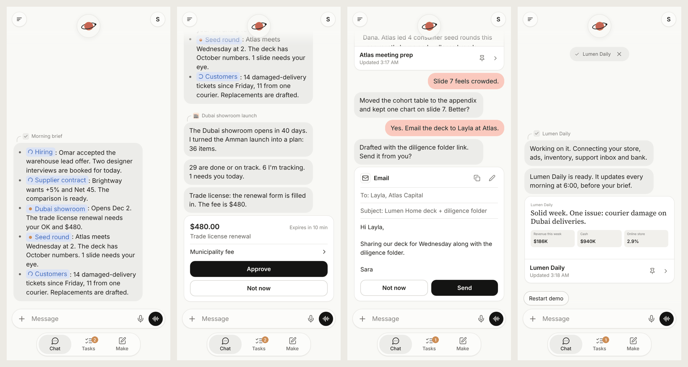
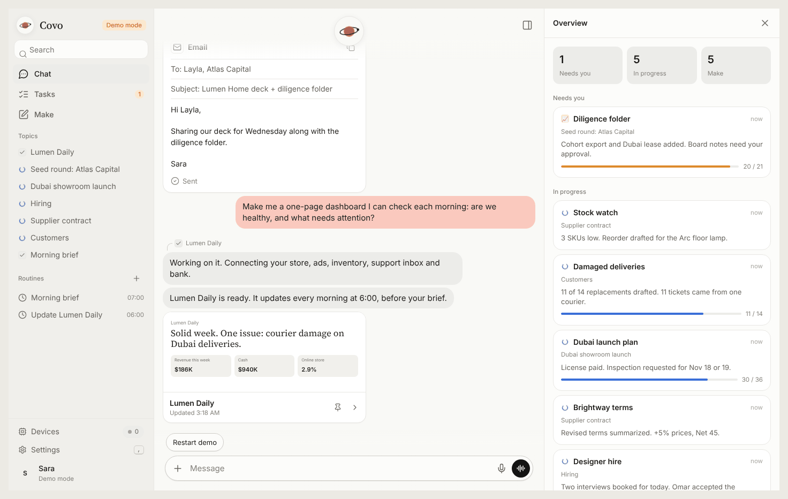

<div align="center">


# Covo

**An open-source alternative to Claude Duet** — a self-hosted autonomous AI agent that runs things end to end,
briefs you every morning, works in the background, and asks you only when it matters.

Run it on your own server, your PC or your phone. Connect it to Claude with your own API key, or to any local
or OpenAI-compatible model (Ollama, LM Studio, OpenRouter). Give it tools, routines and approvals, and it does
the work — drafting, researching, building pages and decks, running commands on your machine — then brings you
the decisions that are actually yours.

Designed and built by **[Ethos](https://github.com/hmody1m)**.

[Download](#download) · [Features](#features) · [Quick start](#quick-start) · [Docs](#docs) · [العربية](README.ar.md)

</div>

> [!IMPORTANT]
> Covo is an independent community project. It is **not affiliated with, endorsed by or sponsored by Anthropic**.
> "Claude" and "Claude Duet" are trademarks of Anthropic, PBC, mentioned only to describe what this project is and that it can use the Anthropic API **with your own API key**. Covo contains no Anthropic code or assets. See [TRADEMARKS.md](TRADEMARKS.md).




**Keywords:** self-hosted AI agent · autonomous AI agent · open-source AI assistant · AI workflow automation · LLM tool calling · approval-gated automation · background AI tasks · scheduled AI routines · MCP (Model Context Protocol) · Ollama · LM Studio · OpenRouter · OpenAI-compatible API · Anthropic Claude API · Electron desktop app · Capacitor Android app · PWA · Node.js · MIT license · alternative to Claude Duet.

## Looking for an alternative to Claude Duet?

Covo is built for exactly that job, as free software you can own and change:

| If you want… | Covo does it |
|---|---|
| The same kind of app, without the lock-in | One continuous thread split into topics, morning brief, approval cards, artifact cards, email drafts, dashboards, Chat · Tasks · Make, the animated orb, lock-screen notifications |
| To run it yourself | Server on Windows, macOS, Linux or a VPS · desktop app · Android app · browser edition — one codebase, five editions |
| To use your own model | Claude with your own API key, or any OpenAI-compatible endpoint (Ollama, LM Studio, OpenRouter…) — plus a keyless demo |
| An agent that actually acts | Tool loop, background tasks, scheduled routines, long-term memory, MCP servers, web search, shell/files, and device control on any PC you pair |
| Control over what it is allowed to do | Approvals per category (Ask / Auto / Block), three autonomy levels, sandboxed artifacts, an editable system prompt, revocable tokens |
| To own and modify the code | MIT license, no telemetry, plain-text source, no build step for the UI |

Search terms this project is meant to be found under: *Claude Duet alternative*, *open-source Claude Duet*, *self-hosted AI agent*, *autonomous agent you can run yourself*, *AI assistant with approvals*, *free alternative to Claude Duet*, *Claude Duet without a subscription*.

Covo is an independent project: it shares no code, assets or affiliation with Anthropic or with Claude Duet.

## Download

| Edition | Get it | Best for |
|---|---|---|
| **Windows app** | `Covo-Setup-x.y.z-x64.exe` (installer) or `Covo-Portable-x.y.z-x64.exe` (no install) | Working on your PC: the agent runs on this computer, with your approval |
| **macOS / Linux app** | `.dmg` · `.AppImage` · `.deb` | Same as above |
| **Android app** | `Covo-x.y.z-android.apk` | Covo in your pocket, or open your own Covo server |
| **Browser edition** | `Covo-x.y.z-web.zip` (unzip and open `index.html`, or serve the folder) | Try it with no install; everything stays in your browser |
| **Server** | This repository (`npm start`, Docker, VPS script) | Always-on agent you reach from every device |

All files are on the [**Releases**](https://github.com/hmody1m/covo/releases) page with a `SHA256SUMS.txt`. Builds may not be code-signed yet, so Windows SmartScreen may say *"Windows protected your PC"* → **More info → Run anyway**, and Android asks you to allow installs from your browser. Only install files from the official Releases page.

## Features

- **One continuous thread, split into topics.** Status chips inside the text, bubbles that appear one at a time, an animated orb that shows what the agent is doing (idle, thinking, writing, working, waiting for you, listening).
- **Chat · Tasks · Make.** Background tasks with live progress and questions for you; *Make* holds the pages, decks, docs and dashboards it builds, with live preview and version history.
- **Approval cards.** Payments, messages, commands and file changes wait for **Approve / Not now**. Email drafts with **Send / Not now / Edit**.
- **A real autonomous agent.** Full tool loop, background tasks, scheduled routines (morning brief), long-term memory, web search & fetch, MCP servers (GitHub, Drive, Slack…), Claude by default — or any OpenAI-compatible model (Ollama, LM Studio, OpenRouter…).
- **Works on your computer.** PowerShell/bash, files, apps, links and screenshots — on the machine running Covo or any PC you pair, even when Covo itself is on a VPS.
- **Safety in code, not in the prompt.** Ask / Auto / Block per category, three autonomy levels, blocked commands, device allow-lists, sandboxed artifacts, passwords, sessions and revocable tokens.
- **You are the developer.** The full system prompt is editable in Settings (4 presets + editor + live preview). Every tool, theme and screen is plain, documented code.
- **11 themes**, custom accent, fonts, density, Arabic & English with full RTL, voice mode, installable PWA with lock-screen notifications, Telegram bridge with approval buttons, export to Markdown/JSON.
- **Built-in demo** that plays a complete, fictional story — no API key needed.
- **Private by design.** No accounts with us, no analytics, no tracking. Fonts are bundled. See [PRIVACY.md](PRIVACY.md).

## Quick start

**Windows app:** run the installer → *Get started* → your name → choose **Claude** and paste an API key from [console.anthropic.com](https://console.anthropic.com/settings/keys) (or a local model, or the demo) → pick a theme. Covo lives in the tray and keeps working when you close the window. Tray → **Allow phone access** lets your phone on the same Wi‑Fi open it (after you set a password).

**Server (Windows / macOS / Linux):**
```bash
npm install
npm start            # → http://localhost:8787
```
Windows without a terminal: double-click `start.bat`, or run `scripts\windows\install-windows.ps1` for a shortcut and auto-start. Details: [docs/DEPLOY_WINDOWS.md](docs/DEPLOY_WINDOWS.md).

**VPS with automatic HTTPS:**
```bash
sudo bash scripts/vps/install.sh      # asks for your domain; Docker + Caddy (Let's Encrypt)
```
Details: [docs/DEPLOY_VPS.md](docs/DEPLOY_VPS.md).

**Let the agent use your computer:** Settings → Devices → *Let the agent use this computer* (desktop app/local server), or **Pair a device** and run the small runner on any PC: [docs/DEVICES.md](docs/DEVICES.md).

## Build it yourself

```bash
npm run build:web     # browser edition → dist/web (static files; host them anywhere)
npm run desktop       # run the desktop app in development
npm run dist:win      # Windows installer + portable .exe → release/
npm run dist:linux    # AppImage + .deb        (dist:mac on a Mac)
npm run apk           # Android APK (needs JDK 21 + Android SDK) → mobile/android/app/build/outputs/apk
npm test              # unit + API tests
```
Tagging `vX.Y.Z` on GitHub builds every edition and publishes a Release automatically (`.github/workflows/release.yml`). See [docs/EDITIONS.md](docs/EDITIONS.md).

## Make it yours

| To change | Where |
|---|---|
| Personality and replies | Settings → **System prompt**, or `server/agent/prompt.js` — [docs/SYSTEM_PROMPT.md](docs/SYSTEM_PROMPT.md) |
| Tools | `server/agent/tools/index.js` (one object per tool) |
| Colors and themes | `web/css/tokens.css` — [docs/DESIGN_SYSTEM.md](docs/DESIGN_SYSTEM.md) |
| UI | `web/js/components/*` (Preact + htm, no build step: edit and refresh) |
| Demo story | `web/js/demo/engine.js`, `content.js` |
| Name, logo, repo links | `node scripts/rename.mjs --name "YourName" --repo you/your-repo` |
| Integrations | REST API + WebSocket — [docs/API.md](docs/API.md) |

## Docs

[Architecture](docs/ARCHITECTURE.md) · [Every button and what happens next](docs/USER_FLOWS.md) · [Editions & builds](docs/EDITIONS.md) · [Windows](docs/DEPLOY_WINDOWS.md) · [VPS](docs/DEPLOY_VPS.md) · [Devices](docs/DEVICES.md) · [API](docs/API.md) · [System prompt](docs/SYSTEM_PROMPT.md) · [Design system](docs/DESIGN_SYSTEM.md)

## Feedback & contributing

Ideas, bugs and questions: [open an issue](https://github.com/hmody1m/covo/issues/new/choose) (also from Settings → About inside the app). Security problems: report privately, see [SECURITY.md](SECURITY.md). Pull requests welcome — read [CONTRIBUTING.md](CONTRIBUTING.md) and the [Code of Conduct](CODE_OF_CONDUCT.md).

## Credits

Covo is designed and built by **Ethos** — concept, product design, the interface, the agent architecture and every
edition (server, desktop, Android, browser, device runner).

- The project is open source under the MIT license, and contributions from the community are welcome and credited
  in the git history.
- Built with open-source software: Preact + htm, Electron, Capacitor, the Anthropic SDK, `ws`, nodemailer,
  web-push. Full list in [THIRD_PARTY_NOTICES.md](THIRD_PARTY_NOTICES.md).

## Legal

- [MIT License](LICENSE) — use it, change it, ship it.
- [Terms of use](TERMS.md) · [Privacy](PRIVACY.md) · [Trademarks & affiliation](TRADEMARKS.md) · [Third-party notices](THIRD_PARTY_NOTICES.md) · [Security](SECURITY.md)
- You use AI providers under your own account and their terms (for Anthropic, including the [Usage Policy](https://www.anthropic.com/legal/aup)). API usage is billed to you by the provider.
- AI output can be wrong. Approvals are on by default for anything that spends money, sends messages or changes your computer — keep them on for things you can't undo.
- The demo company, people and numbers are fictional.
